# APEX OVERLAND

**Open-world offroad point-to-point racing in the browser** — Three.js + Rapier3D + Vite (TypeScript).

▶ **Play: https://fanaustinca.github.io/apex-overland/**

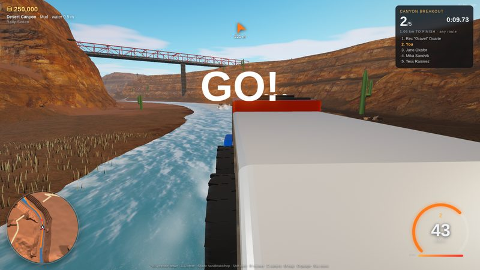

| | |
|---|---|
| 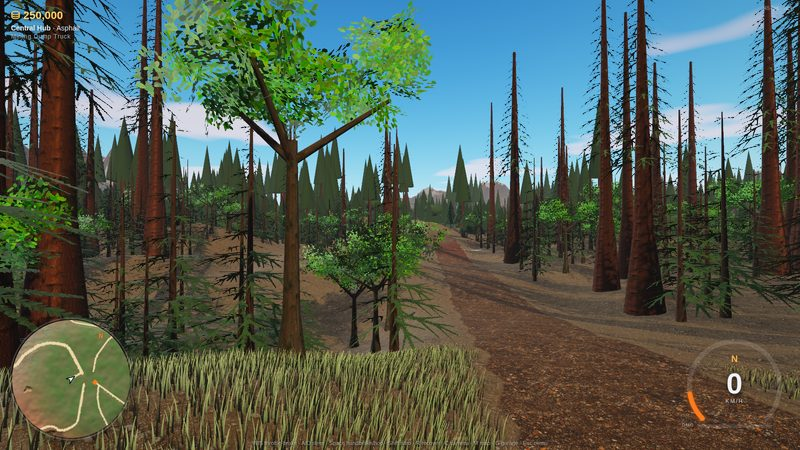 | 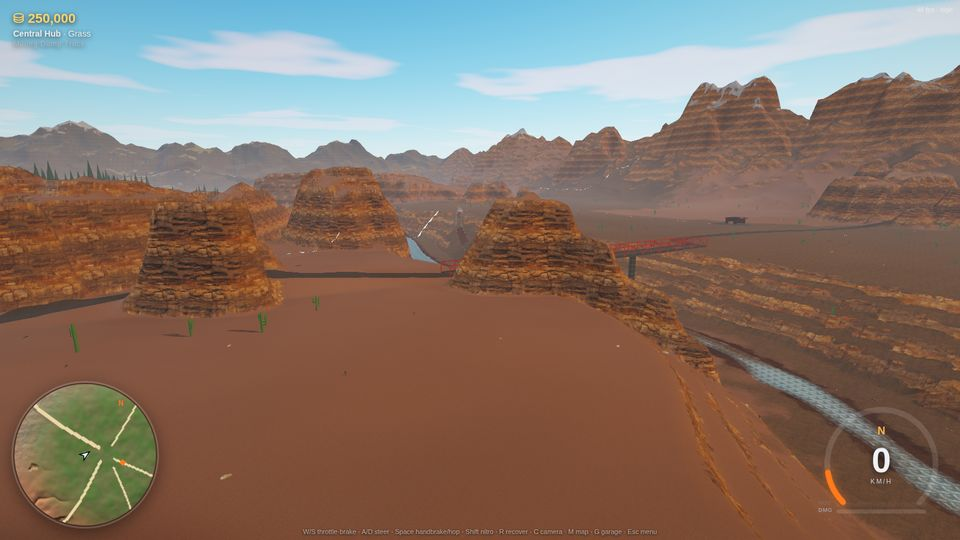 |
| 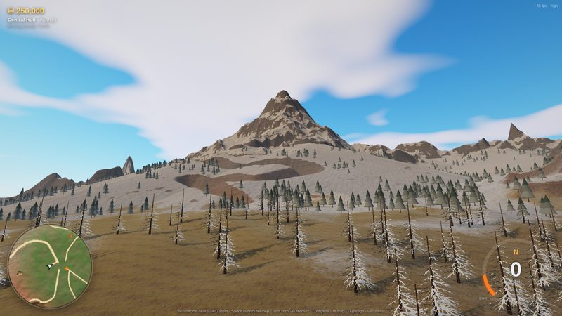 | 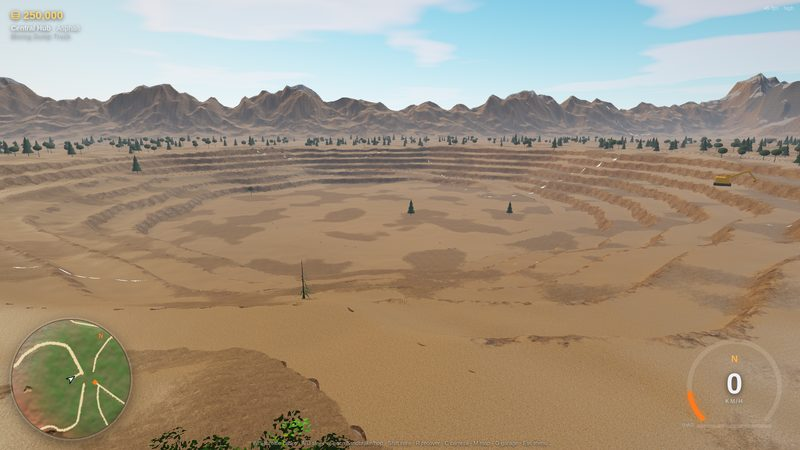 |
| 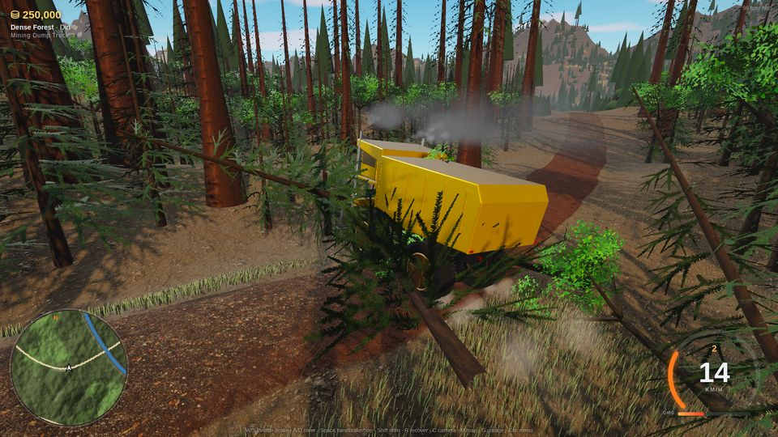 | 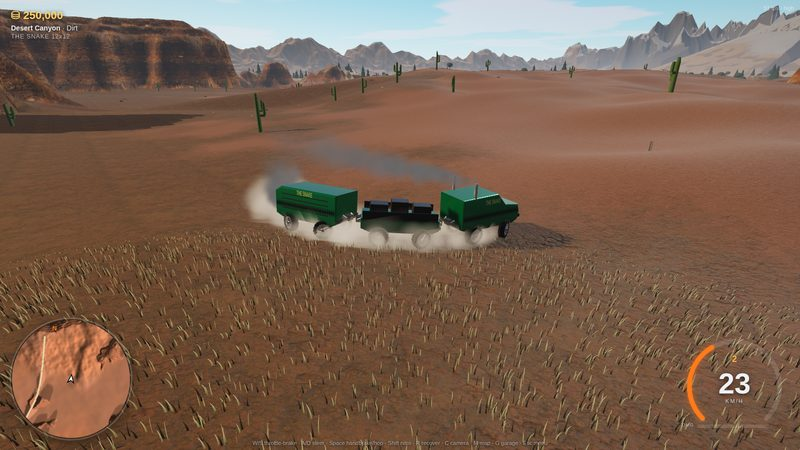 |
| 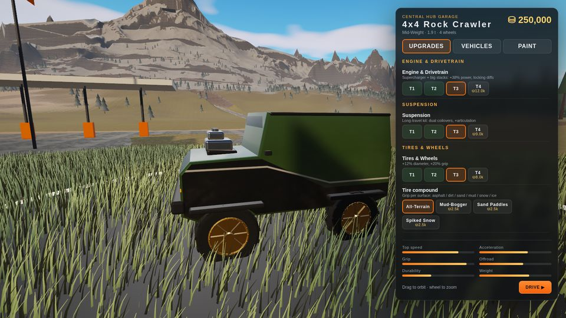 | 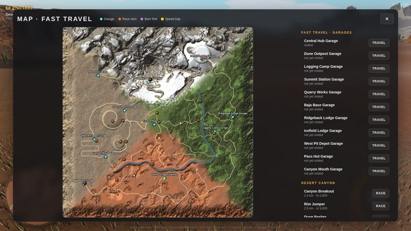 |
| 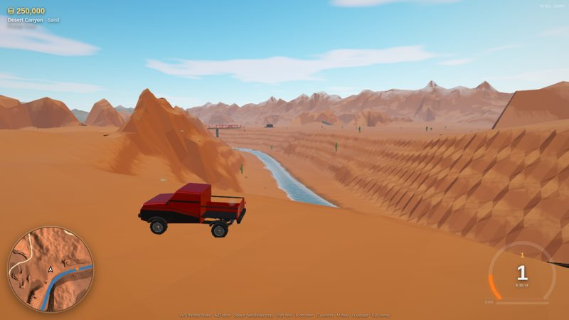 |  |

## The world
One seamless **5.1 km × 5.1 km** world (2 m heightfield, 6.6 M samples, generated across a pool of Web Workers at load) with 200–400 m noise-warped transition belts between four biomes, meeting at the **Central Hub Garage**:

| Biome | Highlights |
|---|---|
| **Desert Canyon** (south) | Red-rock flats, dune sea, mesas, a deep stratified canyon with a shallow river, three bridges (steel truss, timber trestle, stone arch) and rock ramps across the canyon narrows |
| **Dense Forest** (east) | Pines, giant redwoods and broadleaf trees that wall you onto winding dirt roads, Muddy Creek winding down a broad valley into the canyon (bridged at every road crossing; deep pools stall engines without a snorkel), logging camp, the Ridgeback rally road |
| **Snowy Mountain** (north) | Mount Apex: packed-snow switchbacks between plough berms, summit station, Glacier Ridge, the alpine pass, a frozen lake for ice racing |
| **Industrial Quarry** (west) | Two tiered excavation pits with spiral haul ramps, crusher plant, giant excavator, crushable site trailers, drainage culverts, the West Pit motocross track |

The outer ring holds the **Baja run** (desert rally road with tabletop jumps) and the **Ridgeback** (eastern gravel rally stage). **11 garages**; any of them is one click away in the fast-travel list on the map.

Roads are laid out the way real ones are: a grade-aware pathfinder (A* over position + heading, with a minimum hairpin radius) routes every road between its waypoints along the contours, round mesas and up mountains in switchbacks, so roads hug the terrain and only shave a few metres off it. Embankments steepen with distance from their road (so a fill never fans out over the switchback below), the ground between stacked switchback legs is re-laid as one smooth slope, and wherever a road would still run in a slot its flanks are laid back into a broad, open valley, so no road is a trench. The snowy mountains are built from broad, round-shouldered ridges that roll down into the neighbouring biomes, so most of them can be driven, not just the roads. Shallow, irregular earthworks blend them in; junctions meet at the same height; river crossings are proper bridges; outpost garages site themselves beside their road on level ground. `npx tsx tools/audit.ts` checks all of it.

**Landmarks** worth a detour (a gold star on the map once found, with a cash reward for each discovery):
**Impact Crater** (a 350 m meteor crater with a glowing meteorite), **Aircraft Boneyard** (a crashed cargo plane whose broken wing is a ramp, plus a row of retired airliners), **Hoodoo Garden** (sandstone spires and a natural arch you can drive through), **Stunt Park** (kickers, tabletops, a dirt bowl, quarter pipes and a container gap), **The Sinkhole** (a 35 m cenote with a turquoise pool and one ramp down) **Lookout Peak** (a 440 m summit above the Icefield Lodge: an asphalt road switchbacks up its face to a viewing deck, a summit cairn and a weather mast), the **Desert Shipwreck** (a three-master stranded in the dune sea; the dune bank runs up onto her deck), the **Standing Stones** (a ring of monoliths in the forest with two trilithon gates to drive through) and the **Radar Station** (radomes, a giant dish and a lattice mast on a snowy hilltop).

No invisible walls: waypoints only guide the GPS — any line to the finish counts, so cut through forests, dunes and cliffs (the frozen-lake slalom and the MX track make you take every gate).

| 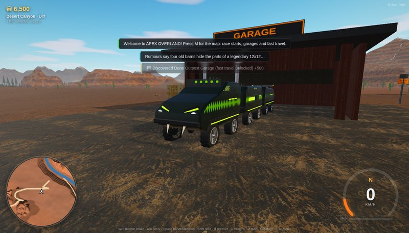 | 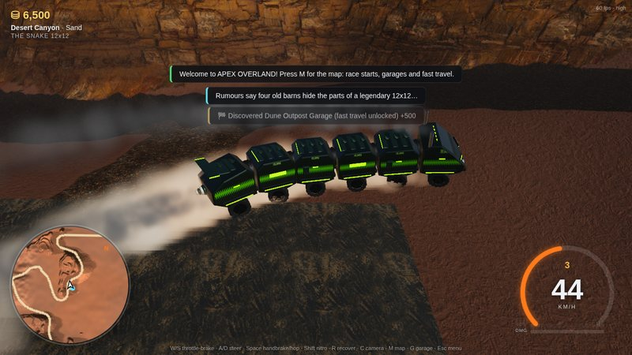 |
|---|---|

## Vehicles (18)
Dirt Bike (lean physics + bunny-hop) · Dune Buggy · Rally Sedan · Offroad Limo · 4x4 Rock Crawler · Expedition SUV · Pickup · 6x6 Luxury Wagon (a boxy V8 wagon cab on a tandem-axle pickup bed) · Dakar Rally Truck · Semi · 8x8 (four-wheel steer) · Monster Truck · **6x6 Monster Truck** (same pace as the Monster, but anti-roll bars, yaw stability, more grip and hill-climbing torque keep it planted) · School Bus · Battle Tank (tracks, neutral pivot steering at ~60°/s) · Mining Dump Truck · and the secret **THE SNAKE 12x12** — six single-axle segments on five short hydraulic articulation joints (springy pitch, firm roll, free yaw) whose axles steer to follow the segment ahead. Its segments never collide with each other, so it can fold tight without snagging on itself, and its tyres cling to steep ground with huge low-speed torque: it climbs 80–85° rock faces.

Every vehicle is procedurally modelled (extruded body profiles with wheel-arch cut-outs, clear-coat paint with liveries, tinted glass, lathe-turned tyres with real tread lugs, live suspension links) and accumulates mud, dust and snow from the surfaces it drives on.

## Modular upgrades
Engine & Drivetrain (T1–4: hood scoop → supercharger + stacks → twin turbos) · Suspension (T1–4: visible colour-coded single/dual coilovers, lift, travel) · Tires & Wheels (T1–4 diameter/grip + All-Terrain / Mud-Bogger / Sand Paddles / Spiked Snow compounds with per-surface grip) · Frame & Roll Cage (roof rails → external exo-cage) · Front Plow (bumper → bull bar → **Heavy Steel Dozer Plow** that lets heavyweights carve straight through forests) · Axles & Skid Plates · Nitrous · Snorkel · Winch. All of them change both the 3-D model and the physics.

## Races (21)
Canyon Breakout · Rim Jumper · Dune Basher · Baja Blast · Timberline Plow · Muddy Creek Run · Logging Camp Sprint · Ridgeback Rally · Avalanche Switchbacks · Peak Descent · Glacier Ridge · Frozen Lake Drift · **Lookout Peak Hillclimb** (lodge to summit, once round the cairn, and back down) · Pit Escape · Crusher Circuit · Haul Road Havoc · Quarry MX · and four cross-biome marathons: **Summit to Sands**, **Quarry to Forest**, **Timber to Canyon**, **Rim of the World**. Positions are ranked by distance still to go, so shortcuts count. AI rivals use pure-pursuit steering with curvature-based speed planning and recovery.

Earn coins from races, speed traps, big jumps (the canyon narrows pay triple) and discovering outpost garages. Press **M** for the fast-travel map.

## Secret barn finds
Four weathered barns hide the parts of The Snake. Look for faint tyre ruts branching off the main trails, broken fences, old *NO TRESPASSING* signposts and chimney smoke.

## Destruction
Medium trees knocked down by heavy vehicles or plows become physical logs (capsule trunk + branch stubs) that stay on the terrain as hazards. Logs are put to sleep after resting for 2 s and the pool is capped at 60 (the oldest log retires gracefully).

## Graphics
Presets **Low-Poly / Potato → Medium → High → Ultra Realism**, plus individual sliders: terrain detail (faceted low-poly ↔ 12-layer height-blended photo-scanned PBR with triplanar cliffs and anti-tiling), shadows (off ↔ 4096 PCF), shadow distance, foliage density (20–100 %), draw distance, particles, resolution, AA (FXAA / MSAA), and toggles for ACES filmic tone mapping, SSAO (GTAO), bloom, volumetric sun god-rays and motion blur. Image-based lighting from a CC0 HDRI, height-fog aerial perspective, GPU grass, wind-swayed foliage, flowing water with fresnel/sun glint.

## Controls
`W/S` throttle / brake-reverse · `A/D` steer · `Space` handbrake (bike: hop) · `Shift` nitrous · `R` recover · `C` camera · `M` map · `G` garage · `Esc` menu · mouse drag to look · gamepad supported.

## Development
```bash
npm install
npm run dev            # http://localhost:8951
npm run build          # type-check + production build (dist/)
npm run test:e2e       # headless Chromium functional suite (SwiftShader; GPU=1 uses the real GPU)
npm run shots          # visual verification → ./screenshots/
npx tsx tools/sim.ts hub-east crawler   # headless vehicle/AI tuning on a road
npx tsx tools/map.ts map.png            # top-down render of the generated world
npx tsx tools/audit.ts                  # every road/junction/garage/race: grades, ridges, drops, dead ends
npx tsx tools/racesim.ts                # AI drives every race headless and reports finishes/resets
node tools/fetch-assets.mjs             # (re)download + pack the CC0 assets
```
Dev console (F12): type `dev.help()` — teleports (`dev.tp`, `dev.garage`, `dev.cabin`), `dev.race`, `dev.finish`, `dev.car`, `dev.coins`, `dev.unlockAll`, `dev.barns`, `dev.pos`, `dev.fps`, `dev.preset` and more. Test API: `AO.state()`, `AO.autopilot()`.

## Credits
Terrain textures, materials, rocks/shrubs and the HDRI are from [Poly Haven](https://polyhaven.com) (CC0) — see `public/assets/CREDITS.txt`. Everything else (vehicles, trees, world, audio) is procedural.
