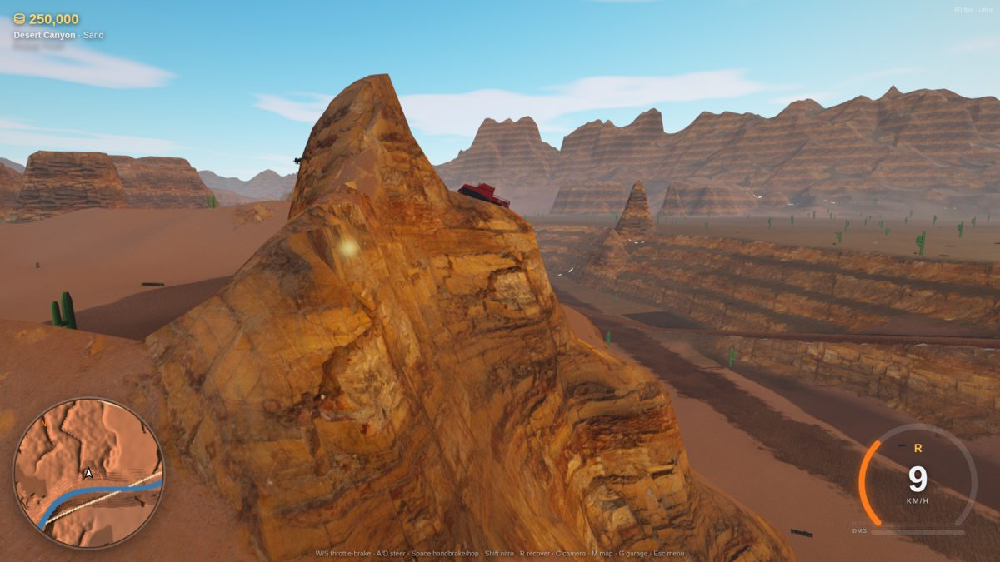

# APEX OVERLAND

**Open-world offroad point-to-point racing in the browser** — Three.js + Rapier3D + Vite (TypeScript).

▶ **Play: https://fanaustinca.github.io/apex-overland/**



## The world
One seamless **4 km × 4 km** world (2 m heightfield, 4.2 M samples, generated in a Web Worker at load) with 200–400 m noise-warped transition belts between four biomes, meeting at the **Central Hub Garage**:

| Biome | Highlights |
|---|---|
| **Desert Canyon** (south) | Red-rock flats, dune sea, mesas, a deep stratified canyon with a shallow river, three bridges (steel truss, timber trestle, stone arch) and rock ramps across the canyon narrows |
| **Dense Forest** (east) | Pines, giant redwoods and broadleaf trees that wall you onto winding dirt roads, Muddy Creek (deep pools stall engines without a snorkel), logging camp |
| **Snowy Mountain** (north) | Mount Apex: eight icy switchbacks, summit station, Glacier Ridge, steep descent lines |
| **Industrial Quarry** (west) | Two tiered excavation pits with spiral haul ramps, crusher plant, giant excavator, crushable site trailers, drainage culverts |

No invisible walls: every race suggests 2–3 GPS routes, but you can cut through forests, dunes and cliffs.

## Vehicles (17)
Dirt Bike (lean physics + bunny-hop) · Dune Buggy · Rally Sedan · Offroad Limo · 4x4 Rock Crawler · Expedition SUV · Pickup · 6x6 · Dakar Rally Truck · Semi · 8x8 (four-wheel steer) · Monster Truck · School Bus · Battle Tank (tracks, neutral pivot steering) · Mining Dump Truck · and the secret **THE SNAKE 12x12** — three 4x4 modules on hydraulic hinges whose trailing axles steer to follow the hitch ahead.

Every vehicle is procedurally modelled (extruded body profiles with wheel-arch cut-outs, clear-coat paint with liveries, tinted glass, lathe-turned tyres with real tread lugs, live suspension links) and accumulates mud, dust and snow from the surfaces it drives on.

## Modular upgrades
Engine & Drivetrain (T1–4: hood scoop → supercharger + stacks → twin turbos) · Suspension (T1–4: visible colour-coded single/dual coilovers, lift, travel) · Tires & Wheels (T1–4 diameter/grip + All-Terrain / Mud-Bogger / Sand Paddles / Spiked Snow compounds with per-surface grip) · Frame & Roll Cage (roof rails → external exo-cage) · Front Plow (bumper → bull bar → **Heavy Steel Dozer Plow** that lets heavyweights carve straight through forests) · Axles & Skid Plates · Nitrous · Snorkel · Winch. All of them change both the 3-D model and the physics.

## Races (15)
Canyon Breakout · Rim Jumper · Dune Basher · Timberline Plow · Muddy Creek Run · Logging Camp Sprint · Avalanche Switchbacks · Peak Descent · Glacier Ridge · Pit Escape · Crusher Circuit · Haul Road Havoc · and three cross-biome marathons: **Summit to Sands**, **Quarry to Glacier**, **Timber to Canyon**. AI rivals use pure-pursuit steering with curvature-based speed planning and recovery.

Earn coins from races, speed traps, big jumps (the canyon narrows pay triple) and discovering outpost garages. Press **M** for the fast-travel map.

## Secret barn finds
Four weathered barns hide the parts of The Snake. Look for faint tyre ruts branching off the main trails, broken fences, old *NO TRESPASSING* signposts and chimney smoke.

## Destruction
Medium trees knocked down by heavy vehicles or plows become physical logs (capsule trunk + branch stubs) that stay on the terrain as hazards. Logs are put to sleep after resting for 2 s and the pool is capped at 60 (the oldest log retires gracefully).

## Graphics
Presets **Low-Poly / Potato → Medium → High → Ultra Realism**, plus individual sliders: terrain detail (faceted low-poly ↔ 12-layer height-blended photo-scanned PBR with triplanar cliffs and anti-tiling), shadows (off ↔ 4096 PCF), shadow distance, foliage density (20–100 %), draw distance, particles, resolution, AA (FXAA / MSAA), and toggles for ACES filmic tone mapping, SSAO (GTAO), bloom, volumetric sun god-rays and motion blur. Image-based lighting from a CC0 HDRI, height-fog aerial perspective, GPU grass, wind-swayed foliage, flowing water with fresnel/sun glint.

## Controls
`W/S` throttle / brake-reverse · `A/D` steer · `Space` handbrake (bike: hop) · `Shift` nitrous · `R` recover · `C` camera · `M` map · `G` garage · `Esc` menu · mouse drag to look · gamepad supported.

## Development
```bash
npm install
npm run dev            # http://localhost:8951
npm run build          # type-check + production build (dist/)
npm run test:e2e       # headless Chromium functional suite (SwiftShader; GPU=1 uses the real GPU)
npm run shots          # visual verification → ./screenshots/
npx tsx tools/sim.ts hub-east crawler   # headless vehicle/AI tuning on a road
npx tsx tools/map.ts map.png            # top-down render of the generated world
node tools/fetch-assets.mjs             # (re)download + pack the CC0 assets
```
Debug API in the browser console: `AO.state()`, `AO.race('rim-jumper')`, `AO.autopilot()`, `AO.game.teleportGarage('desert')`.

## Credits
Terrain textures, materials, rocks/shrubs and the HDRI are from [Poly Haven](https://polyhaven.com) (CC0) — see `public/assets/CREDITS.txt`. Everything else (vehicles, trees, world, audio) is procedural.
